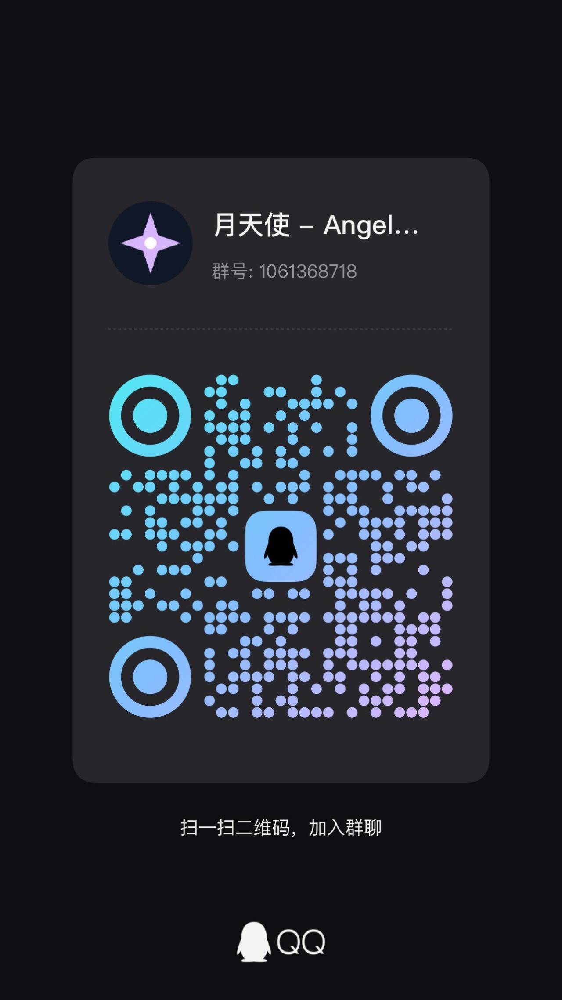

<div align="center">


# Angelus

### 管理一个正在运行的 Agent 组织，而不只是启动一条工作流。

**本地优先 · 可观察 · 可干预 · 可恢复**

[](LICENSE)
[](https://github.com/LunaticLegacy/angelus/actions/workflows/ci.yml)
[](https://github.com/LunaticLegacy/angelus/releases)
[](https://www.python.org/)

[快速开始](#快速开始) · [三个演示](#三个-30-秒演示) · [它是什么](#它是什么) · [能力](#核心能力) · [架构](#架构) · [文档](#文档)

</div>


> **Angelus 把「正在运行的 Agent 组织」当作可观察、可干预、可恢复的一等运行时状态。**
>
> 当多个 Agent 协作执行一个长任务时，你真正需要回答的不是「它下一步跑哪个节点」，而是：
> 现在有哪些 Agent？谁向谁汇报？谁在做什么？为什么？证据在哪？能不能停？能不能改？崩了能不能接着跑？

<details>
<summary><b>In English</b></summary>

Angelus is a **local-first control plane for running agent organizations**. Unlike agent
frameworks that focus on defining workflows or wiring agents together, Angelus treats the
*organization itself* — roster, topology, assignments, per-agent contexts, task bus — as
first-class durable runtime state that you can **observe, intervene in, and recover** from a
desktop workbench. It is not a cloud SaaS: everything runs on your machine.
</details>

---

## 三个 30 秒演示

<!-- TODO(作者): 录屏 GIF —— ① 跑完 Swarm → 重启 → 组织还在；② 运行中改某个 worker 的上下文；③ 上下文回滚 -->

**1. 关掉应用，组织还在** — 跑完一个 3 worker 的 Swarm → 关闭 Angelus → 重新打开 → 同一会话里拓扑、worker、任务、上下文都还在 → 直接派下一个任务，不用从头重建。

**2. 给跑偏的 worker 动手术** — Swarm 运行中某个 worker 开始重复犯错：点开它的私有上下文 → 注入一句修正（或回滚到旧版本）→ 继续跑，兄弟 worker 全程无感。

**3. 上下文回滚** — Agent 被打入错误信息后开始胡说：打开版本化修订历史 → 恢复到健康版本 → 下一回合恢复正常。

> 演示 1 当前覆盖「已完成/已中断」的 Swarm；**运行中**崩溃后从断点继续在路线图中。

---

## 快速开始

### 方式 A：桌面应用（推荐，约 2 分钟）

1. 打开 [Releases](https://github.com/LunaticLegacy/angelus/releases)，下载对应平台的安装包
   （Windows `NSIS`/`MSI`，Linux `deb`/`rpm`）。
2. 安装并打开。桌面壳会自动启动本地后端，**不需要** Python、虚拟环境或命令行。

### 方式 B：从源码运行（约 5 分钟）

需要 **Python 3.12+** 与 Git。

```bash
git clone --recurse-submodules https://github.com/LunaticLegacy/angelus.git
cd angelus

python -m venv .venv
# Linux / macOS
source .venv/bin/activate
# Windows PowerShell
# .\.venv\Scripts\Activate.ps1

python -m pip install --no-build-isolation -r requirements.txt
angelus web --host 127.0.0.1 --port 8765
```

打开 <http://127.0.0.1:8765>。

> `requirements.txt` 会同时安装 `llmfetcher` 子模块与 Angelus 本体。
> 如果子模块是空的，执行 `git submodule update --init --recursive`。

### 第一次运行，做什么

1. 右上角 **设置 → 连接**：填 provider（OpenAI 兼容/Anthropic/LiteLLM/…）、模型、API URL、API Key。
   可以保存为「连接器」，以后复用；密钥只在本机加密保存，永不回传浏览器。
2. 左侧 **新建会话**。
3. 给它一个**多步骤**任务（例如「调研 X，产出带证据的报告」），然后打开右侧面板：
   **任务计划 / Agents / Trace / 用量**。
4. 想体验多 Agent：在设置里打开 **Agent Swarm**，再发任务。

---

## 它是什么

大多数 Agent 框架解决「怎么把 Agent 跑起来」。Angelus 解决「**Agent 跑起来之后怎么办**」。

一个长任务的 Agent 系统，需要能回答：

```text
它现在在做什么？
它为什么这么做？
哪个 Agent 对这件事负责？
这个 Agent 当前拥有什么上下文？
哪个证据支持了这个结论？
哪个任务被阻塞了？
我能不能停掉它 / 修改它 / 恢复它？
```

Angelus 让这些问题成为 **runtime 的一部分**，而不是让你事后翻终端日志猜。

---

## 为什么是 Angelus（设计中心不同）

| 平台 | 主要抽象 | 它主要回答的问题 |
| --- | --- | --- |
| **CrewAI** | Crew / Task / Flow | 一组角色怎么完成既定工作？ |
| **AutoGen** | Agent / Message / Runtime | Agent 之间怎么通信？ |
| **LangGraph** | Node / State / Graph | 状态化工作流怎么可靠执行？ |
| **云端 Agent 平台** | 托管运行时 / 基础设施 | 长任务怎么跑在云上？ |
| **Angelus** | **Agent Organization / Control Plane** | **一个正在运行的 Agent 组织，怎么被看见、被干预、被恢复？** |

这不是「别人做不到」的能力断言，而是 **design center** 的差别：
**Angelus 管理的是「组织」，不是「图」。**

---

## 核心能力

### 观察 · Observe

- **持久化事件账本**（`events.ndjson`）：生命周期、模型轮次、工具调用与结果、TaskBus 活动、计划变更，全部可回放。
- **每 Agent 独立上下文、任务计划、用量与状态灯**——点开任意 worker 就能看它「此刻知道什么」。
- **执行图**：真实的运行时拓扑（coordinator ♛ / worker ↳ / 临时专家），不是静态配置的可视化。
- **Trace / Timeline / Artifacts**：按时间与事件两种视角复盘，产物与证据可追溯。

### 干预 · Surgery

- **Steer**：在安全轮次边界给正在运行的 Agent 注入方向，不必整体重启。
- **停止**：单 Agent 停止、协作式全组织停止、强制停止（并清理已登记的 shell 子进程）。
- **上下文手术**：版本化编辑每个 Agent 的上下文，带 SHA-256 基线与 actor/reason 审计，可回滚到任意修订。
- **计划修改**：任务状态随实际工作流转，而不是两套数据。

### 恢复 · Resurrect

- **组织快照**（`swarm-runtime.json`）：拓扑、worker、分配、TaskBus 历史整体持久化（不含凭据）。
- **进程重启后重建组织**：已完成的 Swarm 会按快照还原，之后回合继续使用同一组织。
- **中断诊断**：服务丢失的运行会显示为 `interrupted` 并持久化，不会伪装成仍在运行。

> 运行中任务的恢复在路线图中（见[状态与路线图](#状态与路线图)）。

### 底层能力

- **LLMFetcher 运行时**：多 provider、流式输出、上下文压缩、图式长期记忆、TaskBus。
- **MCP**：`stdio` 与 Streamable HTTP，全局加密服务器注册表 + 会话级 Agent/工具授权。
- **插件系统**：工具/路由/钩子/连接器/前端面板扩展点，带权限门禁、完整性校验与审计日志（内置 7 个示例插件）。
- **本地优先**：会话、事件、上下文、快照、产物默认都在本机。

---

## 架构

```text
┌────────────────── 浏览器 / Tauri 桌面 ──────────────────┐
│  Sessions · Agents · Plans · Trace · Context · Usage    │
└───────────────────────────┬─────────────────────────────┘
                            │ FastAPI + SSE
┌───────────────────────────▼─────────────────────────────┐
│                    Angelus 控制平面                      │
│  Session Runtime · Run Control · Task Planning           │
│  Context Editing · Event Ledger · Swarm Recovery         │
│  Plugins / MCP / Connectors                              │
└───────────────────────────┬─────────────────────────────┘
                            │
┌───────────────────────────▼─────────────────────────────┐
│                   LLMFetcher 运行时                      │
│  Agent Loop · Provider Backends · Context/Compaction     │
│  Graph Memory · Tools · AgentSwarm · TaskBus             │
└───────────────────────────┬─────────────────────────────┘
                            │
              ┌─────────────┼─────────────┐
              ▼             ▼             ▼
           LLM API      MCP Tools     Local Tools
```

层次刻意分离，每一层都能独立演进：`LLM 执行机制 → Agent 运行时 → Swarm 组织 → 控制平面 → 人类工作台`。

---

## 数据与安全

**local-first**：所有状态默认保存在当前目录的 `.angelus-state/`（可用 `ANGELUS_STATE_DIR` 覆盖）：

```text
.angelus-state/
├── workspaces.json          # 会话索引
├── sessions/<id>/           # 每会话：run profile、上下文、执行记录、检查点
├── settings/                # 连接器元数据、全局运行配置
├── secrets/connectors/      # 只写密钥文档（RSA-OAEP-SHA256 加密）
└── plugins/                 # 插件私有状态
```

**安全边界**（详见 [docs/security.md](docs/security.md)）：

- API Key 只在本机加密保存，运行时服务端解密，**永不回传浏览器**；
- 插件能力（shell / network / fs / env / connector…）按 scope 授权，未授权一律拒绝并记审计日志；
- 插件 manifest/entry 做 SHA-256 完整性校验，改一字节即拒绝加载；
- 强制停止会清理已登记的 shell 子进程。

---

## 这不是什么

- **不是又一个 Agent 框架**：你不必用 Angelus 重写 agent 逻辑；底层是独立的 `llmfetcher`。
- **不是云端可观测 SaaS**：没有账号、没有上传、没有按量计费。
- **不是 Kubernetes Agent 基础设施**：它是单个工作站上的控制台。
- **不是通用聊天客户端**：它是给「需要理解 Agent 到底在干什么」的人用的。

---

## 状态与路线图

- **当前版本**：`v0.6.0`（[CHANGELOG](CHANGELOG.md)），处于活跃开发阶段，持久化格式与 UI 仍可能变化。
- **发布**：桌面安装包由 GitHub Actions 在 `v*` tag 上自动构建（Linux / Windows）。
- **测试**：59 个测试模块（`python -m pytest tests -v`），CI 覆盖 Python 3.12 / 3.14。

**下一步（按优先级）**

1. 运行中组织恢复（重启后从断点继续，而非仅完成态）。
2. 失败语义补齐：不丢失已完成的工具副作用。
3. 异构 Coding Agent 统一控制（Codex / Claude Code / OpenCode 适配器补齐）。
4. 更多插件与示例（目前内置 GZCTF、POFP-CTF 等 7 个）。

---

## 开发

```bash
python -m pytest tests -v                 # 测试
cargo check --manifest-path src-tauri/Cargo.toml   # 检查桌面端
npm run build                             # 构建桌面安装包
npm run build:backend                     # 单独构建 Python sidecar
```

仓库地图见 [INDEX.md](INDEX.md)，架构语义见 [docs/semantic-map.md](docs/semantic-map.md)。

---

## 文档

| 主题 | 文档 |
| --- | --- |
| 架构与代码语义 | [docs/semantic-map.md](docs/semantic-map.md) |
| 安全模型 | [docs/security.md](docs/security.md) |
| 插件开发 / API | [docs/plugin-guide.md](docs/plugin-guide.md) · [docs/plugin-api.md](docs/plugin-api.md) |
| 上下文与图记忆 | [docs/graph_context_design.md](docs/graph_context_design.md) |
| 设计决策 | [docs/decisions.md](docs/decisions.md) |
| 发布说明 | [CHANGELOG.md](CHANGELOG.md) |

---

## 社区与许可

问题与想法：GitHub Issues。也欢迎通过 QQ 群交流：



**许可证**：Apache-2.0（允许商用、修改与分发，需保留版权声明与许可文本）。
`llmfetcher` 为独立仓库，遵循其自身许可。

<div align="center">

**不要只是运行 Agent。要真正驾驭它们。**

</div>
